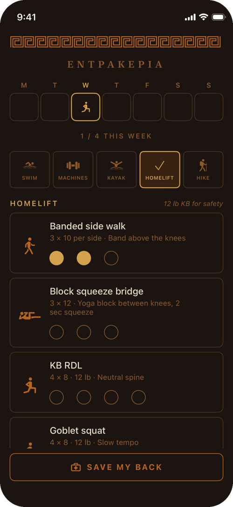
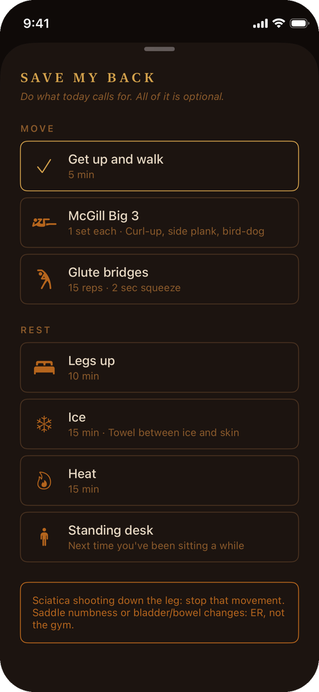
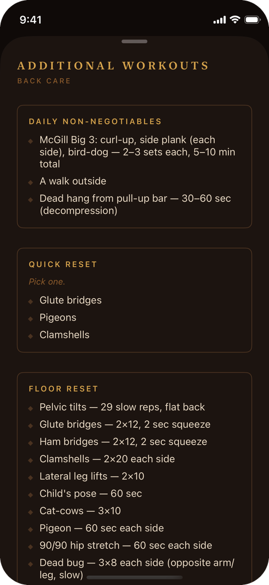
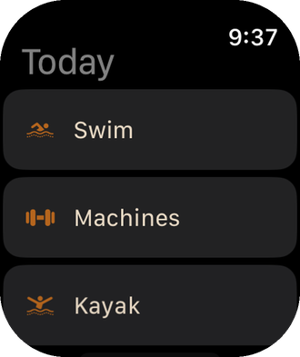
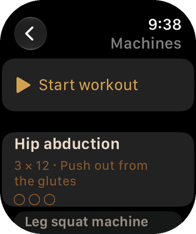

<p align="center">
  
</p>

Entrakeria is a small workout tracker for iPhone and Apple Watch. The name comes from *enkrateia*, the Greek word for self-mastery.

There's no fixed schedule. The week starts blank, and you put four stops on whichever days work: swim, machines, kayak and a lift at home. A hike is the optional bonus. When your back complains, Save My Back is one tap away.

<p align="center">
  
  
  
</p>
<p align="center">
  
  
</p>

## What it does

- **Blank week.** Place a stop on any day. A stop counts once you check off a set.
- **Set tracking.** Each exercise is a card with a dot per set. Tap the last filled dot to undo.
- **Save My Back.** A short list of movement and rest options that clears each day.
- **Additional workouts.** Warm-ups, floor routines, home plans and rules of thumb.
- **Apple Watch.** Check off sets on your wrist. Workouts started there are saved to Apple Health and count toward your rings.
- **Tetrad.** The original four-day diamond tracker, behind a small link on the home screen.

Workout plans are plain Swift data in [`WeekPlan.swift`](WeekPlan.swift), so swapping in your own exercises is a quick edit. Nothing leaves the device, and there are no accounts or third-party packages.

## Building

You need Xcode, [XcodeGen](https://github.com/yonaskolb/XcodeGen) and an Apple developer team. The app targets iOS 17 and watchOS 10.

```sh
brew install xcodegen
cp Signing.xcconfig.example Signing.xcconfig   # then set your team ID
xcodegen generate
open Entrakeria.xcodeproj
```

The Xcode project is generated from `project.yml` and isn't committed. Run a signed build to test watch workouts, because Apple Health access depends on the signed entitlement.

## Layout

| Path | What's there |
| --- | --- |
| `WeekPlan.swift` | Stops, exercises and the Save My Back list, shared by both apps |
| `Models.swift` | SwiftData models |
| `Views/` | iPhone screens, including the Greek key border in `MeanderBand.swift` |
| `Watch/` | Watch app and the HealthKit workout session |
| `SessionManager.swift`, `TetradGeometry.swift` | The tetrad tracker's state and geometry |

## Known issues

- Set check-offs don't sync between the phone and the watch yet. Workouts reach the phone through Apple Health.
- In the tetrad tracker, a burst of taps once logged all four exercises instead of one. It hasn't been root-caused, and it may have been replayed simulator input.
- The swim workout assumes a 25-yard pool.

## Not medical advice

The exercises are one person's notes and aren't a treatment plan. If you have a back injury, check with a clinician first.

## License

[MIT](LICENSE)
