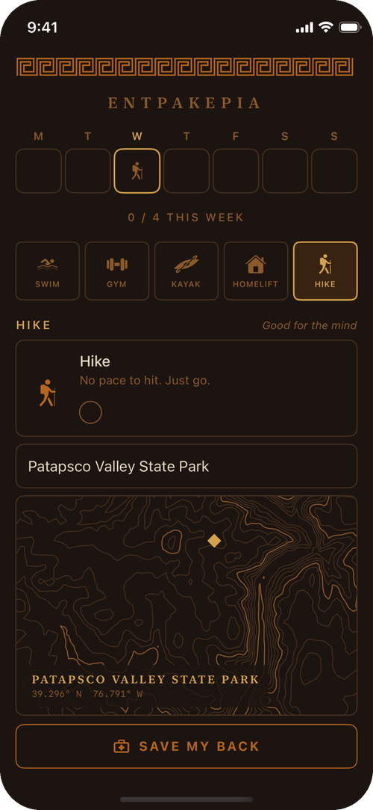

<p align="center">
  
</p>

Entrakeria is a small workout tracker for iPhone and Apple Watch. The name comes from *enkrateia*, the Greek word for self-mastery.

The week starts blank, and you put your stops on whichever days work: swim, gym, kayak, a lift at home, and a hike when you can. Type in where you hiked and it draws the real terrain as a contour map.

<p align="center">
  
</p>

## Building

You need Xcode, [XcodeGen](https://github.com/yonaskolb/XcodeGen) and an Apple developer team.

```sh
brew install xcodegen
cp Signing.xcconfig.example Signing.xcconfig   # then set your team ID
xcodegen generate
open Entrakeria.xcodeproj
```

Hike maps search with Apple Maps and fetch elevation data from the [AWS Terrain Tiles](https://registry.opendata.aws/terrain-tiles/) open dataset. There are no accounts.

The exercises are one person's notes and aren't medical advice. If you have a back injury, check with a clinician first.

[MIT License](LICENSE)
